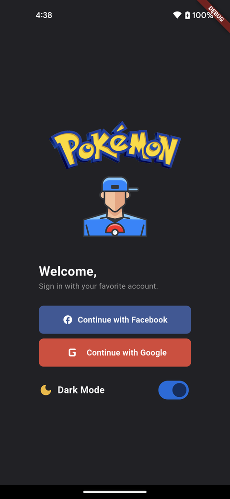
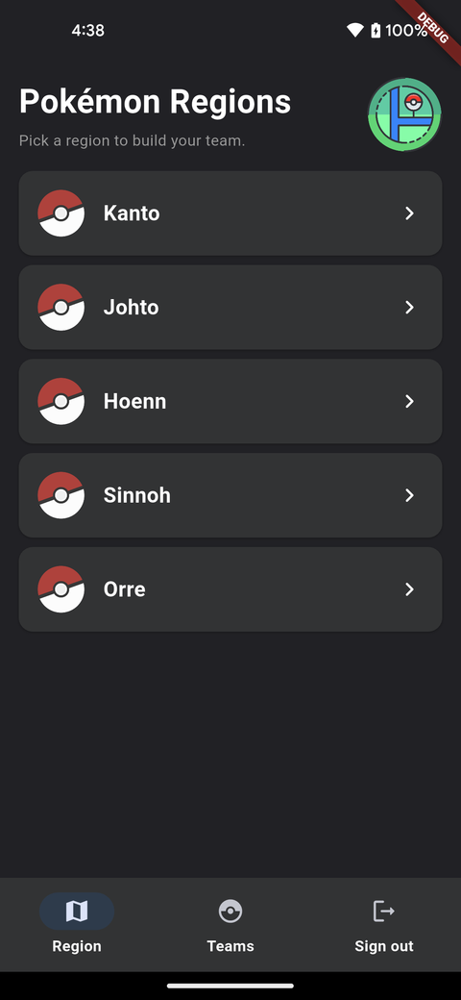
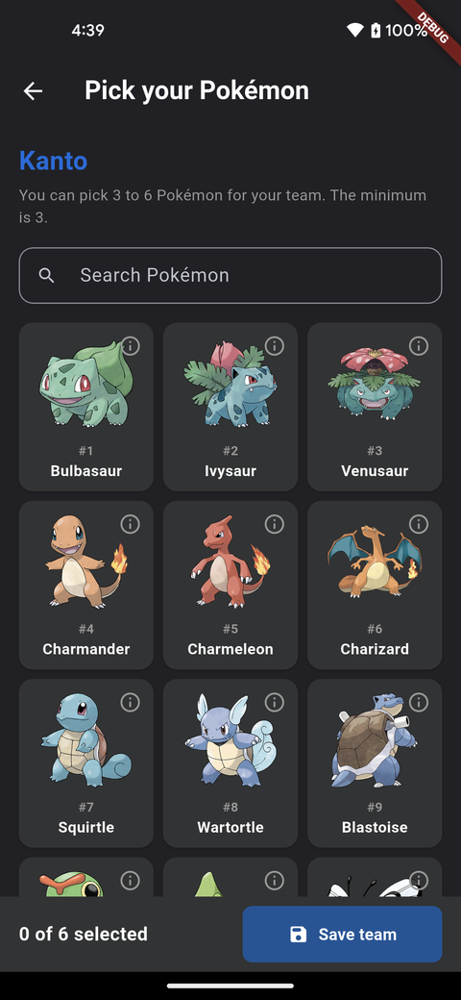
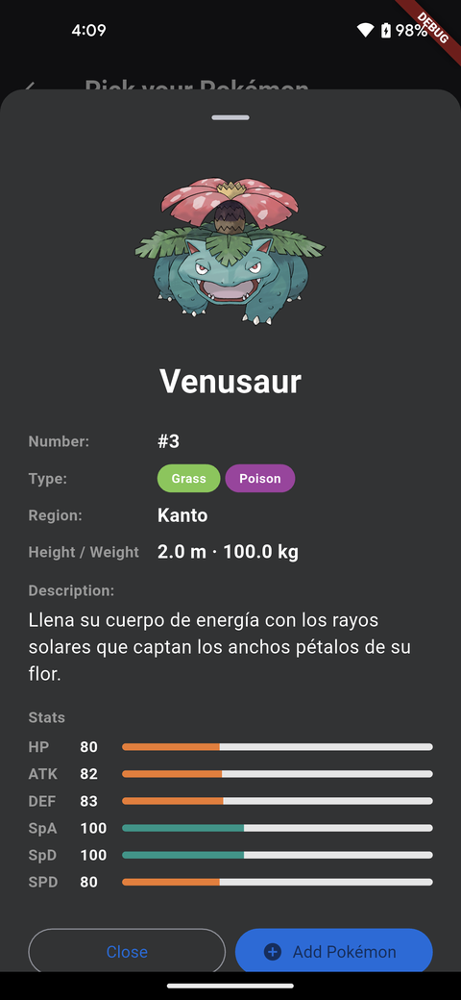
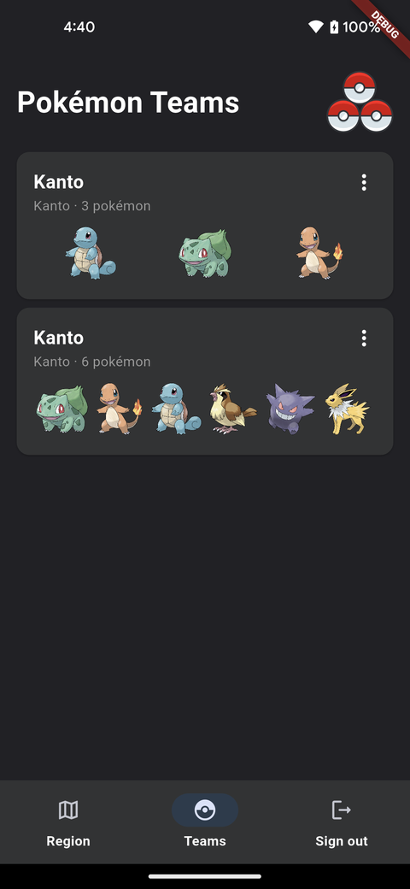

# PokeApp (Flutter)

Migración de la app Android nativa `PokeApp` (Kotlin, `com.jjh.pokeapp2`) a Flutter
(nuevo `applicationId`/bundle id: `com.jjh.pokeapp`),
siguiendo la estructura y configuración de **funcapital** (Clean Architecture + Cubit + get_it).

## Preview

| Login | Regiones | Selección de equipo |
|---|---|---|
|  |  |  |

| Detalle de Pokémon | Equipos guardados |
|---|---|
|  |  |

## Funcionalidad migrada

| Android original | Flutter |
|---|---|
| `SplashActivity` | `ui/features/init` (SplashCubit: decide login / dashboard según sesión) |
| `LoginFragment` + `ViewModelLogin` (Google + Firebase) | `ui/features/login` + `FirebaseAuthDataSourceImpl` |
| Switch Modo Oscuro (`AppCompatDelegate` + SharedPreferences) | `ThemeCubit` + `SettingsLocalDataSource` |
| `HomeHost` + BottomNavigationView (Región / Equipos / Cerrar sesión) | `ui/features/dashboard` (NavigationBar) |
| `RegionFragment` + `ViewModelRegion` (region → pokédex → pokémon) | `ui/features/region` + `GetRegionPokemonUseCase` |
| `SelectFragment` / `sheetDialogDetalle` (no estaban en el repo) | `ui/features/select` + `ui/features/pokemon_detail` |
| `TeamFragment` (equipos de 3 a 6, compartir/renombrar/eliminar) | `ui/features/team` + sqflite (`TeamDao`) |

Fuera de alcance: el login con Facebook (en Android el botón no tenía implementación;
aquí muestra "próximamente").

## Estructura

```
lib/
  main.dart | main_dev.dart | main_mock.dart
  src/
    config/constants/      EnvConstants (dev / prod)
    core/                  di (get_it), mock, resources (DataState, i18n keys), routes, tools
    data/                  dto (freezed+json), remote (PokeAPI/Dio, Firebase), local (sqflite, prefs), repository
    domain/                model (data / ui states), mappers, repository (abstract), uses_cases
    ui/                    features/<feature>/{screen, cubit, widgets}, widgets compartidos, tools
design_system/             tokens (colores Android, Roboto), theme claro/oscuro, atoms
res/i18n/                  es_ES.json, en_US.json (package localization)
test/                      data_sources, mappers, use cases, cubits (mocktail + bloc_test)
```

## Flavors

- `lib/main.dart` — producción (PokeAPI + Firebase).
- `lib/main_dev.dart` — desarrollo con logs HTTP (logarte + awesome_dio_interceptor).
- `lib/main_mock.dart` — datos locales, sin red ni Firebase (`core/mock`).

Soporta Android, iOS y Web (`flutter run -d chrome -t lib/main_mock.dart`).

## Firebase / Google Sign-In

- Proyecto Firebase propio: **pokeappflutter-167ec**, con una app Android registrada para
  el `applicationId` `com.jjh.pokeapp` (`android/app/google-services.json`, ya versionado).
- El login con Google valida el SHA-1 del keystore con el que se firma el APK contra los
  registrados en ese proyecto. Si compilas con un keystore distinto (p. ej. uno de release
  propio), debes agregar su SHA-1 en Firebase Console → proyecto `pokeappflutter-167ec` →
  ⚙️ Configuración del proyecto → tu app Android → *Huellas digitales del certificado SHA*,
  y asegurarte de que **Authentication → Sign-in method → Google** esté habilitado.
- iOS: agrega `ios/Runner/GoogleService-Info.plist` (para el bundle id `com.jjh.pokeapp`) y el
  `REVERSED_CLIENT_ID` como URL scheme. Sin esa config la app funciona y el login muestra
  "Firebase no está configurado".

Ver `commands.txt` para los comandos habituales.
